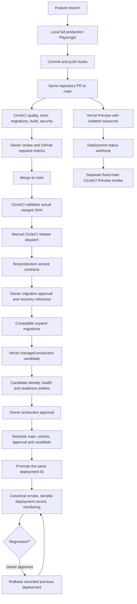

# Portfolio operations

Custom CI/CD runs in CircleCI. All Playwright tests run locally before every
commit and push. Vercel remains the managed Preview/production hosting service;
Turso and Blob remain separate production/nonproduction resources.

The migration is implemented in repository source but account setup, local
verification, CircleCI acceptance and production activation require their own
recorded evidence. Start with the [active migration checklist](./ci-cd-todo.md).
The [previous Actions rollout](./ci-cd-github-actions-history.md) retains its exact
historical checkmarks and evidence; none establishes CircleCI completion.

## Start here

1. Record the live production deployment and recovery option. Keep automatic
   production Git deployments and domain assignment disabled. See [Vercel](./vercel.md).
2. Follow [CircleCI setup](./circleci.md) from account creation through project
   isolation, scoped credentials, triggers and owner approval identity.
3. Install the [local browser hooks](./testing.md#developer-setup) in each clone.
   Prove both operations block on a failed complete production suite.
4. Run CircleCI validation on the migration PR and coordinate the
   [GitHub ruleset switch](./github.md) before removing old Actions requirements.
5. Prove the actual merged-main checks, automatic Preview smoke, service contracts,
   scoped approvals and recovery before deliberately enabling releases.
6. Follow the [release/incident runbook](./releases.md), retaining evidence and
   [service isolation](./services.md) throughout.

## Architecture

CircleCI's production serial group spans both approval waits. Read-only API
metadata verifies who approved the current workflow; automation cannot approve
itself. GitHub environments retain deployment history and do not supply these new
execution approval gates. Vercel native Deployment Checks remain disabled.

## Source and execution ownership

- `.circleci/config.yml`: PR/main validation, security, contracts, release,
  rollback and baseline. No Playwright invocation or browser installation.
- `.circleci/preview.yml`: isolated fixed-main automatic HTTP Preview probes.
- `scripts/production-harness.mts`: synthetic build/start/HTTPS lifecycle;
  `ci:build` uses it without browsers and local E2E adds the full browser suite.
- Release/approval/validation controllers: exact SHA, current-workflow owner
  approval, fresh provider results and backward-compatible deployment records.
- [Testing](./testing.md): coverage inventory, hook setup and hosted local acceptance.
- [CircleCI](./circleci.md): owner settings, credential matrix, schedules and costs.
- [GitHub](./github.md): source protections, native security and Dependabot.

## Runtime, tooling and privacy

Use Node 24 and pnpm 12.18.0 with frozen lockfile and ignored lifecycle scripts.
Husky installation remains explicit because the package policy disables scripts.
CircleCI uses the pinned image and transient checksum-verified pnpm/Gitleaks/CodeQL
archives. Weekly owner review maintains those pins. This migration adds no
application/package dependencies or local Docker prerequisite.

No dependency/browser/build/Docker-layer cache is restored in CI. Public Cache
Components, ISR/data caches and CDN behavior remain intentional application
features. Vercel still requires `VERCEL_FORCE_NO_BUILD_CACHE=1` for candidate builds.

Ordinary PR jobs receive no deployment context. Fork PRs are outside CI scope.
Cloud build fixtures and local browser fixtures contain synthetic data only.
Remote contracts use an empty owned nonproduction DB and Blob objects. Production
smoke probes never mutate CMS content or retain authenticated browser recordings.

Upload only explicitly selected diagnostics and identity metadata. Never upload
all `.ci`, environment files, databases, TLS private keys or browser storage state.
CircleCI diagnostics are short-lived; deployment records and the private evidence
archive satisfy durable release retention. Review classified logs and provider
quotas independently of a green pipeline.

## Verification evidence

The authorized 2026-10-20 local baseline is historical evidence for that version,
not for this migration. The explicitly authorized 2026-11-08 pre-commit pass
completed all nine root checks, including 798 Vitest tests across 74 files and
the production build. Implementation commit `fc23790` passed all 180 local
production Playwright tests without retries. See [testing evidence](./testing.md).
No local checks are authorized by implementation approval alone.
The dedicated nine-check pre-commit subagent policy remains in force; an explicit
push request additionally authorizes the mandatory local Playwright gate.
External settings and release drills stay open in the migration checklist until
there is actual account/run/deployment evidence.
