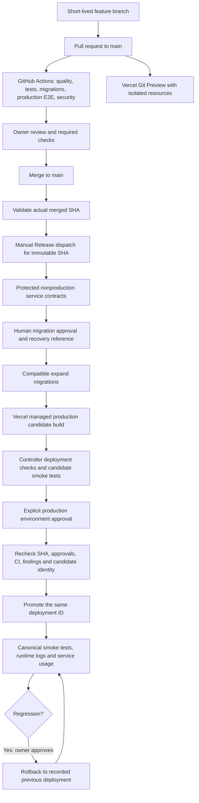

# Portfolio operations

The combined implementation passed authorized local pre-commit verification on
2026-10-20 using Node.js 24.18.0 and pnpm 12.14.0. The owner explicitly requested
commits and waived the dedicated verification subagent for this pass. The standing
agent policy remains unchanged. External setup and hosted release acceptance below
remain the owner's responsibility.

## Start here

The service guide includes the [Preview administrator setup command](./services.md#create-the-preview-administrator).
Record platform setup, validation, release and recovery evidence privately as you
work through these operational guides.

Perform these steps in order:

1. Freeze automatic production promotion in the existing Vercel project before
   changing production branches. Record the current live deployment and recovery
   options. See [Vercel](./vercel.md).
2. Provision separate nonproduction Turso resources and Blob store. Review the
   existing production database ledger and recovery window. See [services](./services.md).
3. Configure GitHub environments, environment-scoped credentials, and required
   reviewers **before enabling release operations**. See [GitHub](./github.md).
4. Complete the history-preserving `restructure` → `main` baseline PR and change
   the default/production branches. Run all required checks on the merged SHA.
5. Run protected service contracts and Preview acceptance. Baseline an existing
   production database only after exact schema comparison and recovery preparation.
6. Exercise a staged release, rejection, stale-release rejection, smoke failure,
   and rollback drill. Retain evidence before considering the system operational.

Do not treat a written workflow as proof that any of these settings are enabled.

## Architecture

Vercel's native GitHub Deployment Checks are deliberately not enabled. Native
checks and automatic domain assignment do not supply the independent human gate
required here. This implementation uses GitHub's protected environment approval
and an API controller around Vercel's managed build/promotion service. Git Preview
builds remain Vercel-managed; Actions does not upload a second production build.
See [staged deployments](https://vercel.com/docs/deployments/managing-deployments#staged-deployments)
and [GitHub environment protection](https://docs.github.com/en/actions/reference/workflows-and-actions/deployments-and-environments).

## Files and responsibilities

| Area                      | Repository implementation                                               | External prerequisite                              |
| ------------------------- | ----------------------------------------------------------------------- | -------------------------------------------------- |
| PR/merged validation      | `.github/workflows/ci.yml`                                              | Ruleset and Actions policy                         |
| Dependency/secret checks  | `security.yml`, Dependabot, pinned Gitleaks bootstrap                   | Alerts, updates, push protection                   |
| Code scanning             | `codeql.yml`, SARIF severity gate                                       | Advanced configuration enabled; default setup off  |
| Preview                   | `preview-checks.yml`, bounded origin verification                       | Git integration and isolated Preview configuration |
| Real service fidelity     | `services-contracts.yml`, `scripts/contracts.mts`                       | Dedicated Turso group and nonproduction Blob token |
| Controlled release        | `release.yml`, `scripts/release.mts`, approval checks                   | Protected environments and Vercel settings         |
| SQL evolution             | committed migrations, policy hashes, guarded migration/baseline tooling | Backup/recovery and existing-ledger reconciliation |
| Error/performance signals | classified JSON operation logs and safe error boundaries                | Vercel Runtime Logs access                         |
| Liveness/readiness        | `/api/health`, `/api/ready`                                             | Readiness credential in protected GitHub jobs      |

## Runtime and package policy

`.nvmrc` follows Node 24's maintained major; GitHub and Vercel must both use 24.x.
This accepts security patches without routinely rewriting three patch pins.
`packageManager` pins pnpm 12.14.0; the lockfile is committed. Engines reject another
Node major or pnpm major. CI installs with `--frozen-lockfile --ignore-scripts`.

`ignoreScripts: true` is in `pnpm-workspace.yaml`, where pnpm 12 policy belongs.
Existing `allowBuilds`, `minimumReleaseAge`, explicit exceptions and security
overrides are retained. Do not globally enable lifecycle scripts to fix a package.
Husky installation remains an explicit developer action. No Corepack prerequisite
is introduced. CI uses the pinned pnpm Action; Vercel uses native pnpm verified by checksum
bootstraps because its documented automatic pnpm provisioning does not establish
support for this exact pnpm 12 version.

There are no dependency download caches, browser caches, build artifact caches,
`.next/cache` restores, or Turbopack build cache persistence in Actions. Vercel
requires `VERCEL_FORCE_NO_BUILD_CACHE=1`; provider-internal images/download layers
cannot all be controlled by repository files. Next.js runtime Cache Components,
ISR/data caches and CDN caching remain application behavior and are preserved.

## Added dependencies

| Addition                             | Necessity and maintenance                          | Existing alternative considered                                               |
| ------------------------------------ | -------------------------------------------------- | ----------------------------------------------------------------------------- |
| `@vitest/coverage-v8@4.1.12`         | Match Vitest exactly; V8 coverage and risk gates   | Vitest requires a coverage provider; no second test runner                    |
| `@testing-library/user-event@14.6.1` | Realistic pending/form interactions                | Keep `fireEvent` for low-level submissions, not as an interaction replacement |
| `@testing-library/jest-dom@6.9.1`    | Accessible, readable DOM assertions                | Existing RTL renders components but does not provide these matchers           |
| `@axe-core/playwright@4.11.1`        | Automated WCAG checks in real browsers             | Manual accessibility review remains necessary                                 |
| `@types/geojson@7946.0.16`           | Declare the map component's GeoJSON types directly | Transitive package visibility is not guaranteed by pnpm                       |

Pinned native Gitleaks and pnpm archives are tools, not runtime packages.
Their URLs/checksums in `tooling/binaries.json` need reviewed
updates. No Docker, Vercel CLI dependency, MSW, or hosted browser service was added.

Initial dependency resolution reported deprecation and peer advisories. The
authorized frozen installation completed without warnings; this does not establish
that upstream deprecations are resolved. Review them when updating dependencies.
Never run `audit:fix` in CI or against protected branches.

## Local verification evidence

The following commands passed on the combined change set on 2026-10-20. This
historical evidence does not verify subsequent changes:

- `git status --short` and `git diff --check`: reviewed file scope and whitespace.
- `pnpm install --frozen-lockfile --ignore-scripts`: reproducible local installation.
- `pnpm format:check`, `pnpm lint`, and `pnpm exec tsc --noEmit`.
- `pnpm exec vitest run`: 606 tests across 61 files.
- `pnpm exec vitest run --coverage`: all configured risk thresholds passed;
  overall line coverage was 82.5%.
- `pnpm spellcheck`, `pnpm knip`, and `pnpm depcruise`.
- Explicit CSpell validation of all eight `.github` workflow/configuration files,
  which the regular spelling command's default file discovery skips.
- `pnpm migrate:check`: clean schema and every migration prefix replayed.
- `pnpm dlx react-doctor@latest . --verbose --scope changed --base HEAD`:
  no diagnostics across 34 changed files; heuristic score 65/100.
- `pnpm build`: production output built against an owned synthetic database with
  local credential values cleared for the child process.

The Next.js **No build cache found** advisory is expected under the explicit
no-build-cache requirement; it is not a missing correctness prerequisite. Full
document navigation after login/logout intentionally discards session-dependent
router state, with narrowly documented lint exceptions at those two calls.
Runtime-generated CI fixture paths opt out of deployment file tracing.

Production browser journeys, hosted service contracts, GitHub security workflows,
and platform approval/recovery drills were not run locally.
See [testing inventory](./testing.md) for coverage limits and the
[release runbook](./releases.md) for external acceptance. Hosted deployment readiness
remains unproven until those checks and platform drills succeed.
